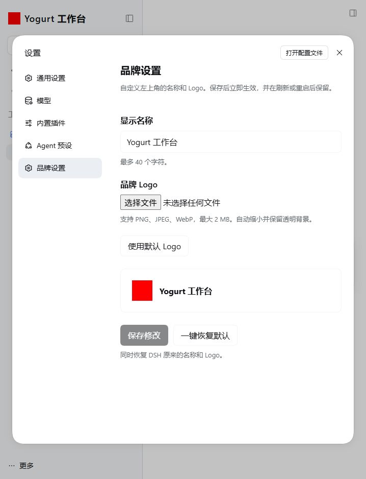
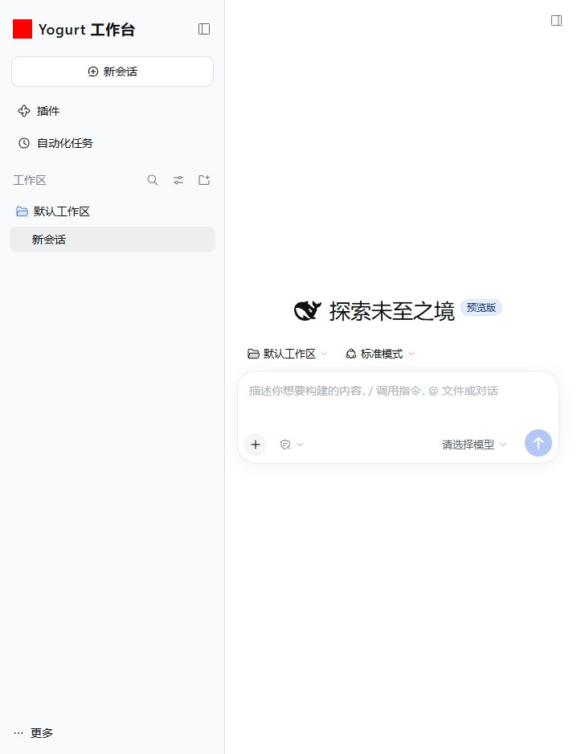
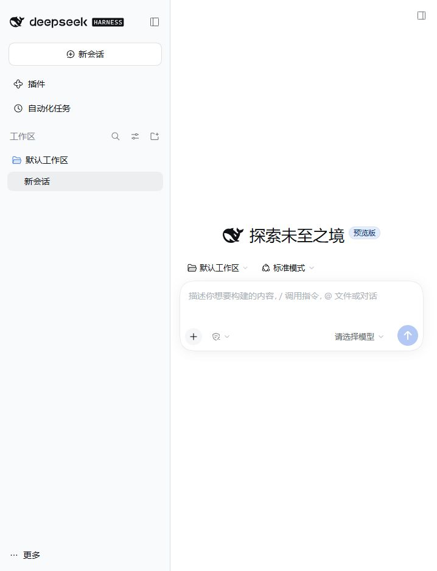

# DSH Branding

在 DSH 的「设置 → 品牌设置」中更换左上角的名称和 Logo，并一键恢复原来的 DSH 品牌。

当前版本：`0.1.0-dev.1`（开发版）。已验证 **DeepSeek Harness 0.2.1-rc.2 / Windows Web profile**；其他宿主版本及原生桌面 profile 尚未验收。

## 功能

- 自定义显示名称，最多 40 个字符，留空使用原来的名称。
- 上传 PNG / JPEG / WebP Logo（最大 2 MB、最长边 4096 像素）。浏览器自动缩放到最长边 128 像素，并转换为保留透明度的 PNG。
- 上传后先预览，点击「保存修改」后立即更新侧栏，包括收起状态的 Logo。
- 通过 DSH 原生设置服务保存，刷新页面、重启宿主后保留；同一 profile 的已连接浏览器通过原生配置通知同步。
- 「使用默认 Logo」可单独还原 Logo；「一键恢复默认」立即同时还原名称和 Logo。
- 还原、停用或卸载插件时，释放原生品牌 slot 的覆盖，重新显示宿主原有品牌。不会替换、删除或修改 DSH 安装文件。
- 中英文界面、浅色/深色主题、只读配置提示、保存失败提示和并发修改保护。



## 安装

在已安装 **DSH 0.2.1-rc.2** 的环境运行：

```sh
dsh plugin --profile web add github:yogurtss/dsh-branding#dev
```

重启对应的 DSH 实例，打开左下角「更多 → 设置 → 品牌设置」。本仓库提交完整 `lib/` 构建产物，无需批准依赖构建脚本。

如果使用桌面版，应把 `web` 换成实际运行的 `desktop` profile，再完全退出并重新打开 DSH；此入口尚未做原生桌面验收。不要只安装到另一个 profile。

插件仅定制侧栏的名称和 Logo，不修改窗口标题、网页 favicon、欢迎页图标或应用可执行文件名称。

## 还原与卸载

在「品牌设置」点击 **一键恢复默认**，立即恢复当前宿主本来的名称和 Logo，无需重启。它会清空本插件的两个品牌字段，不影响模型、会话或其他设置。

彻底移除插件：

```sh
dsh plugin --profile web remove @yogurtss/dsh-branding
```

随后重启该 profile。DSH 可能保留插件的配置覆盖；如果希望下次安装也使用原始品牌，请在卸载前先点击「一键恢复默认」。

Logo 缩略图保存在 DSH 对应 profile 的配置中，不上传至外部图片服务。配置文件可能包含这张图片的 base64 数据，分享配置前请自行检查。

## 开发与验证

Node.js `^22.19.0 || >=24`，pnpm 11：

```sh
pnpm install --frozen-lockfile
pnpm verify
pnpm pack --pack-destination artifacts
```

Host / client 分开做 TypeScript 检查；client 仅导入平台提供的 React 运行时，使用宿主原生 slots、locale、configForms。名称和 Logo 通过一次带版本校验的 `ConfigForm.mutate()` 原子保存。

构建产物随源码一起提交，安装不依赖 `prepare`。更改源码后应重新构建并提交 `lib/`。未发布到 npm。

详细测试范围、宿主源码依据和命名检查见 [验证记录](docs/verification.md)。

## 界面效果

测试用红色方块代表上传的 Logo：



一键还原后：


